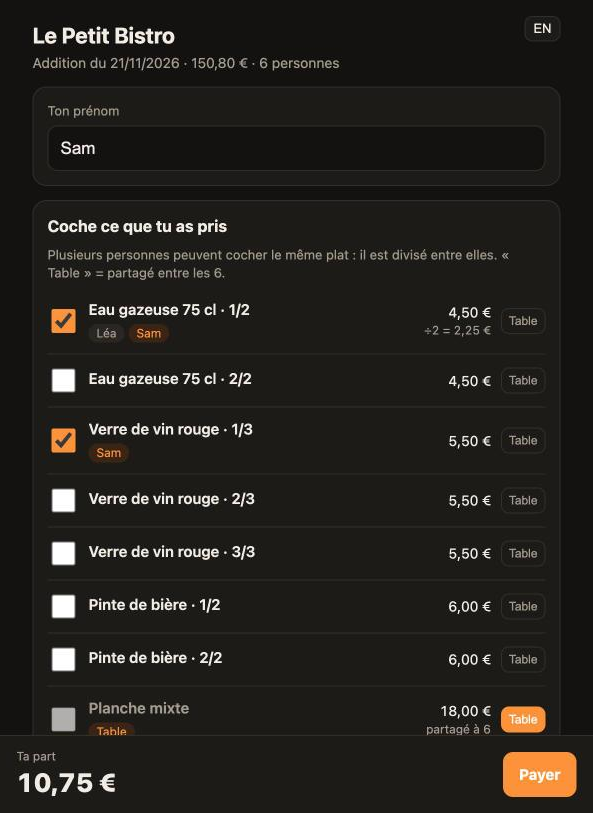

# Partage l'addition du resto, avec une seule photo

Une petite appli web pour partager une addition entre amis.
Chacun scanne un QR code, met son prénom et coche ce qu'il a pris.
Il voit tout de suite ce qu'il doit, et comment te rembourser.



- **Gratuit** : l'appli tourne sur l'offre gratuite de Cloudflare.
- **Rien à installer pour tes amis** : pas de compte, pas d'appli, juste un lien.
- **Plats partagés** : si deux personnes cochent le même plat, il est divisé entre elles.
- **Bouton « Table »** : pour ce que tout le monde a partagé (la bouteille, l'entrée).
- **En français et en anglais**, avec un bouton pour changer.

Tu as vu ça dans la vidéo de **La Minute IA** : « J'ai remplacé Tricount en six minutes vingt-trois, avec une seule photo ».
Ce dépôt te donne le prompt et le code, gratuitement.

---

## Méthode 1 : avec Claude Code (la plus simple)

Il te faut :

- **Claude Code**, avec un abonnement Claude (Pro ou plus) ;
- un **compte Cloudflare** gratuit ([dash.cloudflare.com/sign-up](https://dash.cloudflare.com/sign-up)) ;
- **Node.js** version 20 ou plus. Si tu ne l'as pas, demande à Claude Code de l'installer avec toi.

Ensuite :

1. Prends le ticket en photo. Mets la photo dans un dossier vide, sous le nom `ticket.jpg`.
2. Ouvre un terminal dans ce dossier et tape `claude`.
3. Colle ce prompt :

```text
Je veux partager l'addition d'un resto avec mes amis. Voici la photo du ticket : ticket.jpg.

1. Télécharge le modèle : git clone https://github.com/laminuteia/partage-addition
   puis copie ticket.jpg dans le dossier partage-addition et travaille dedans.
2. Lis le ticket ligne par ligne et remplis addition.json : nom du resto, date,
   chaque plat avec sa quantité et le prix d'UN exemplaire, et le total du ticket.
3. Avant d'aller plus loin, pose-moi ces questions : combien on était, mon prénom,
   et comment on me rembourse (lien Lydia, Wero, PayPal ou Revolut, et/ou IBAN).
4. Lance npm install puis npm run verifier. Si le total ne tombe pas juste,
   relis le ticket, corrige, et relance jusqu'à ce que ce soit bon.
5. Connecte-moi à Cloudflare avec npx wrangler login, puis mets en ligne avec npm run deploy.
6. Donne-moi l'adresse de l'appli et affiche son QR code avec npm run qr -- <adresse>.
7. Ouvre l'appli, coche un plat pour tester, puis décoche-le.
```

4. Montre le QR code à tes amis. C'est fini.

---

## Méthode 2 : à la main

1. Télécharge ce dépôt : bouton vert **Code**, puis **Download ZIP**. Ouvre le dossier dans un terminal.
2. Ouvre `addition.json` et remplace l'exemple par ton ticket :

| Champ | Ce que tu mets | Exemple |
|---|---|---|
| `titre` | le nom du resto | `"Le Petit Bistro"` |
| `date` | la date, au format AAAA-MM-JJ | `"2026-11-21"` |
| `personnes` | combien vous étiez | `6` |
| `devise` | la monnaie, en 3 lettres | `"EUR"` |
| `langue` | la langue de la page au départ, `fr` ou `en` | `"fr"` |
| `payeur` | le prénom de celui qui a payé | `"Alex"` |
| `paiements` | comment te rembourser : un `lien` (bouton) ou un `texte` (à copier) | voir le fichier |
| `lignes` | chaque plat : `nom`, `quantite`, `prix` d'**un** exemplaire | `{ "nom": "Café", "quantite": 4, "prix": 2.2 }` |
| `total_ticket` | le total écrit sur le ticket | `150.8` |

3. Installe les outils : `npm install`
4. Vérifie ton fichier : `npm run verifier`. Il te dit si la somme des plats donne bien le total du ticket.
5. Pour essayer sur ton ordi : `npm run dev`, puis ouvre <http://localhost:8787>.
6. Connecte-toi à Cloudflare : `npx wrangler login`
7. Mets en ligne : `npm run deploy`. Ton adresse ressemble à `https://partage-addition.<ton-compte>.workers.dev`.
8. Affiche le QR code : `npm run qr -- https://partage-addition.<ton-compte>.workers.dev`

---

## Tout faire de zéro, comme dans la vidéo

Dans la vidéo, il n'y a pas de modèle. Un seul message à Claude Code suffit, et il écrit toute l'appli :

```text
Tu peux faire une mini app sur Cloudflare pour partager une addition de resto entre 7 ?
Voilà le ticket : ticket.jpg. Les gens mettent leur prénom, cochent ce qu'ils ont pris,
et voient mon Revolut (@ton-revtag). Déploie-la, puis teste-la.
```

L'appli obtenue change un peu à chaque fois. Ce dépôt, c'est une version propre et testée de la même idée.

---

## Bonus : piloter Claude Code depuis ton téléphone

C'est ce que j'ai fait au resto. Claude Code tournait sur mon ordi, et je lui parlais depuis mon téléphone. J'ai même envoyé la photo du ticket depuis la table.

Il te faut :

- un abonnement Claude (Pro ou plus). Ça ne marche pas avec une clé API ;
- l'appli Claude sur ton téléphone (iPhone ou Android), avec le même compte ;
- ton ordi allumé, avec le terminal ouvert.

1. Sur l'ordi, ouvre un terminal dans ton dossier et tape `claude`.
2. Dans Claude Code, tape `/remote-control`. Un QR code s'affiche.
3. Scanne-le avec ton téléphone. Tu peux aussi ouvrir l'appli Claude, toucher **Code**, puis ta session : elle a une icône d'ordi avec un point vert.
4. C'est prêt. Tu écris depuis le téléphone, tu peux envoyer une photo, et tout tourne sur ton ordi.

Bon à savoir :

- Si tu fermes le terminal, la session se coupe. Si l'ordi se met en veille, elle revient toute seule au réveil.
- Ton ordi n'ouvre aucune porte vers l'extérieur : tout passe par les serveurs d'Anthropic, en connexion chiffrée.
- La doc officielle : [code.claude.com/docs/en/remote-control](https://code.claude.com/docs/en/remote-control)

---

## Comment ça marche

- `addition.json` : ton ticket. C'est le seul fichier à modifier.
- `src/worker.js` : la page et une petite API, sur un **Worker** Cloudflare.
- Un **Durable Object** garde la liste de qui a coché quoi. Les écritures passent une par une : deux amis qui cochent en même temps ne s'effacent pas.
- La page se met à jour toute seule toutes les 4 secondes.
- `verifier.mjs` : contrôle le fichier avant chaque mise en ligne.

## Bon à savoir

- Toute personne qui a le lien peut cocher. Ne le partage qu'avec ton groupe.
- Pas de compte et pas de cookie : le prénom reste dans le téléphone de chacun.
- Nouvelle addition : modifie `addition.json` (le titre ou la date) et relance `npm run deploy`. La liste repart de zéro.
- Pour tout effacer : `npx wrangler delete`.
- Coût : 0 €. L'offre gratuite de Cloudflare permet 100 000 requêtes par jour, bien plus qu'un dîner.

## Licence

MIT : tu peux tout reprendre, modifier et partager.

---

Fait par **La Minute IA**. Abonne-toi pour la prochaine appli :
[la-minute-ia.fr](https://la-minute-ia.fr) · TikTok [@la_minute_ia](https://www.tiktok.com/@la_minute_ia) · X [@laminuteia](https://x.com/laminuteia)

English version: [five-minute-ai/split-the-bill](https://github.com/five-minute-ai/split-the-bill)
